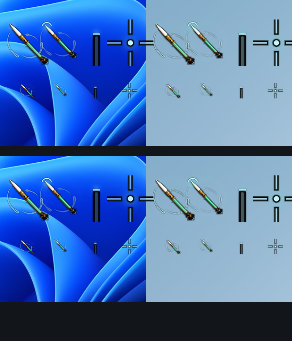
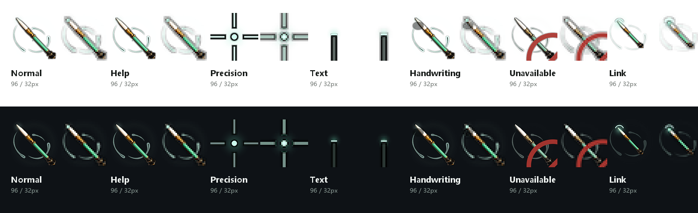
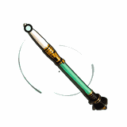
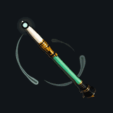
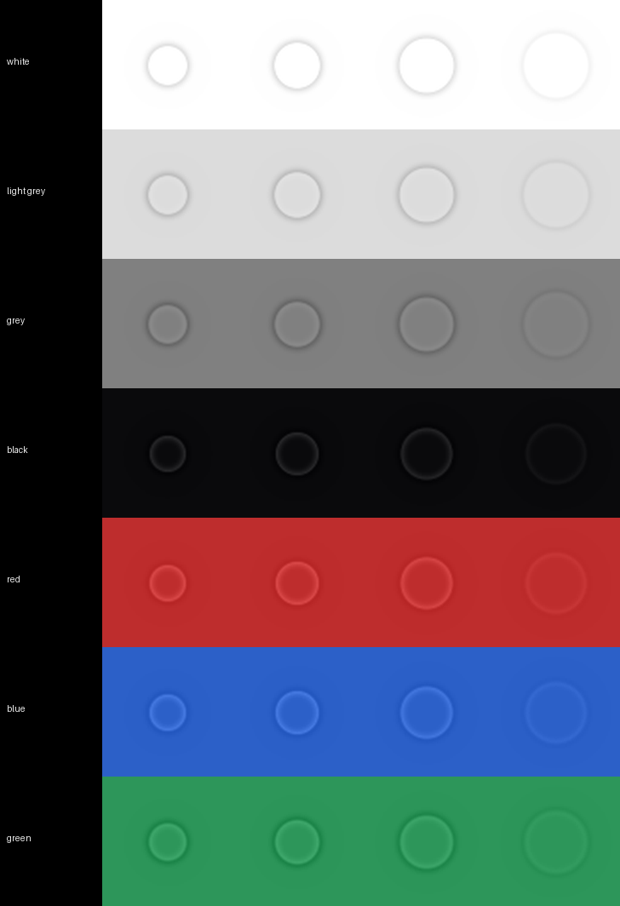
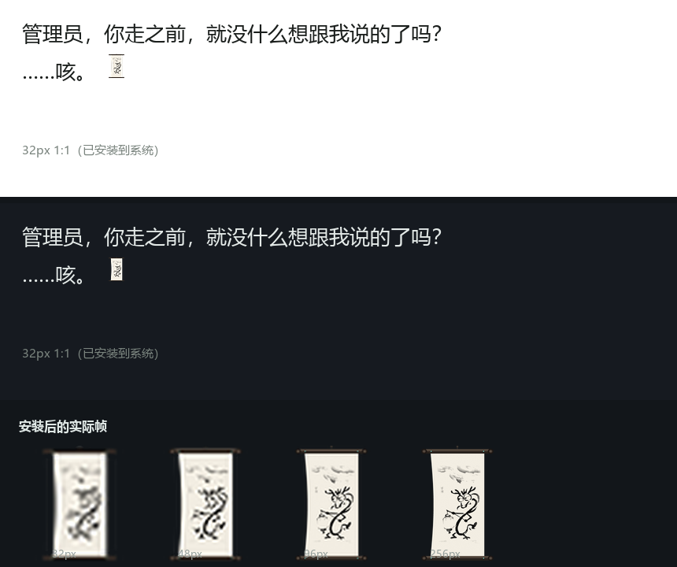

# 祀の笔 · 终末地水墨指针组

**Endfield Ink Cursor Kit** — 用《明日方舟：终末地》干员「祀」的毛笔做的整套 Windows 鼠标指针、点击水墨涟漪、画卷文本光标。

从抠图、调色、动画到 `.cur` / `.ani` 二进制封装，全部由脚本生成，没有一个像素是手工导出的。

> 个人同人作品，非商用。角色「祀」及相关美术版权归 © HYPERGRYPH / 鹰角网络所有。



---

## 目录

- [效果](#效果)
- [包含内容](#包含内容)
- [安装](#安装)
- [设计思路](#设计思路)
- [技术实现](#技术实现)
- [构建](#构建)
- [已知限制](#已知限制)
- [版权](#版权)
- [English](#english)

---

## 效果

### 指针组

七种静态指针 + 三种动画指针，笔尖就是光标热点，笔身内部有缓慢流动的青光。



| 动画 | 亮底 | 暗底 |
|---|---|---|
| 正常选择（16 帧，笔身青光流动 + 呼吸） |  |  |

### 点击：一滴墨落进水里

点击时在光标位置绽开一圈水波，是真实的**波面折射**——背后画面会随波面弯折，而不是盖一层半透明贴图。

难点在于「消失」：环以恒定速度继续外扩，只有对比度在最后 60% 平滑归零，所以是**边扩边淡 到看不见**，不会向内缩、也不会在某个圈上突然消失。

亮暗由背景亮度决定：白底走暗边（淡灰水纹），黑底走亮边（微光），彩色两者都有。



### 文本光标：一幅立轴

把缘缘庄墙上那幅「提灯龙」做成了 I 形光标——上下木轴、米色纸、弯弧、墨迹乘算进纸里。



---

## 包含内容

```
cursors/
  NormalSelect.ani      正常选择（16 帧 / 64px / 青光流动）
  NormalSelect.cur      静态版
  HelpSelect.cur        帮助选择
  WorkinginBackground.ani  后台运行（8 帧墨点）
  Busy.ani              忙（10 帧）
  PrecisionSelect.cur   精确选择（十字）
  TextSelect.cur        文本选择
  Handwriting.cur       手写
  Unavailable.cur       不可用
  LinkSelect.cur        链接选择
  ScrollText.cur        画卷文本光标（32–256 七档）
  SiInkClick.exe        点击涟漪小工具（托盘常驻）
  install.cmd           一键安装全部指针
  install-static.cmd    只装静态指针
  install-text-cursor.cmd  替换文本光标
  restore.cmd / restore-text-cursor.cmd  还原
assets/
  scroll_lantern_dragon.png   提灯龙（从游戏画面还原，1165×1867）
  scroll_master_2k.png        立轴母版 2048×2048
tools/
  artlib.py          绘图库：笔身、青光、墨韵、描边、缩放
  build_all.py       生成全部 .cur / .ani
  SiInkClick.cs      点击特效源码
  tc_v4.py           文本光标生成
```

---

## 安装

Windows 10/11。**不需要管理员权限**（写入 `%LOCALAPPDATA%\Cursors`）。

1. 下载仓库，双击 `cursors/install.cmd` —— 全套指针 + 文本光标
2. 只想用静态的：`cursors/install-static.cmd`
3. 只想换文本光标：`cursors/install-text-cursor.cmd`
4. 还原：`cursors/restore.cmd` / `cursors/restore-text-cursor.cmd`

安装脚本会写 `HKCU\Control Panel\Cursors` 并调用 `SystemParametersInfo(SPI_SETCURSORS)` 立即生效。

> 系统执行策略为 Restricted 时，`.ps1` 双击会被拦截，请用附带的 `.cmd` 包装（已内置 `-ExecutionPolicy Bypass`）。

### 点击特效

`SiInkClick.exe` 常驻托盘，用低级鼠标钩子监听左键。想开机自启就丢进
`%APPDATA%\Microsoft\Windows\Start Menu\Programs\Startup`。

---

## 设计思路

**颜色贴着壁纸走。** 一开始是玉绿色，但主流桌面（Win11 Bloom）是大面积冷蓝，绿色笔杆压不住。改成冷青 `#68DED6` 主体 + 冷白光晕，笔杆内部再叠两层反向流动的亮带，看起来像玉里有光在走。

**墨韵要双色。** 单一色调的墨丝在白底看不见、在深底是脏斑。改成「墨芯 + 冷白晕」的双层描边后，两种背景上都能成形。

**光标的辨识度靠笔尖。** 32px 下细节全部丢失，所以热点定在笔尖，形状上保证「斜向一撇」的剪影轮廓，缩到 32px 仍能和系统箭头区分。

---

## 技术实现

### 抠图

立绘背景是白色，边缘有半透明抗锯齿和色溢。做法：四角泛洪求背景色 → 逐像素判定物体（饱和度 / 亮度双阈值）→ 对边缘像素做去色溢（`c = (c - bg*α)/(1-α)`）→ 生成 alpha。烘死的投影会变成灰方块，所以另外用环形采样做了去阴影。

### 缩放

所有尺寸都由 1024 母版重采样：预乘 alpha、在线性光空间做 Lanczos、再按尺寸单独描边 + UnsharpMask。直接缩 RGB 会让边缘发黑。

### `.cur` / `.ani`

没有用任何第三方库，纯 Python 写二进制：

- `.cur`：ICONDIR + ICONDIRENTRY + 32bpp BGRA DIB（自下而上），alpha 走 0 通道而非掩码
- `.ani`：RIFF 容器，`anih`(36 字节) + `rate` + `seq ` + `LIST fram`，每帧是完整的 `.cur` 文件

### 点击涟漪

`.ani` 本身无法响应点击，所以用 C# 写了一个托盘程序：

- `WH_MOUSE_LL` 低级钩子捕获点击
- 每次点击抓 76×76 屏幕像素，做**波面高度场径向折射**：`h = A·exp(-((r-Rf)/σ)²)`，位移 `= ∇h · gain`
- 明暗按斜率给：迎水面提亮、背水面压暗，所以整圈都有体积感（不是只亮半圈）
- **alpha 跟随波强**：只有「水在动」的那圈才画出来，平坦处全透明 —— 没有方形补丁，也就没有边界白圈
- 对比度按抓到的背景平均亮度自适应（亮底走暗边、暗底走亮边）
- 时间驱动（Stopwatch），720ms，最高约 90fps，最后 60% 用 smoothstep 把对比度降到 0

### 文本光标

游戏截图里那幅画只有 338×489。流程是：局部光照归一化 → 取「比纸暗多少」作为墨的 alpha → 4 倍重采样 → 合成到新纸面（纤维噪点 + 淡墨晕）→ 逐行 `sin(πt)` 位移做弯弧 → 叠木轴。

---

## 构建

```bash
# 指针（需要 Pillow + numpy）
python tools/build_all.py

# 点击特效（.NET Framework 自带编译器）
csc /nologo /unsafe /target:winexe /out:SiInkClick.exe /win32icon:app.ico \
    /resource:app.ico,AppIcon /r:System.dll /r:System.Drawing.dll \
    /r:System.Windows.Forms.dll SiInkClick.cs

# 文本光标
python tools/tc_v4.py
```

---

## 已知限制

- **源图分辨率是硬上限**。提灯龙原画只有 338×489，还原版在 96px 以上仍偏软；有更高清的截图可以重跑流程。
- 仅 Windows（`.cur` / `.ani` 是 Win32 格式）。
- 点击特效会截取光标周围的屏幕像素，**在被 DRM 保护的窗口上会失效**（如部分全屏游戏）。
- 动画指针的帧率受系统光标动画设置影响。

---

## 版权

- 角色「祀」、毛笔造型、《终末地》相关美术：© HYPERGRYPH / 上海鹰角网络科技有限公司
- 本仓库是**个人同人作品**，仅供学习与个人使用，**禁止商用**，请勿二次分发美术资源。
- 代码部分（`tools/`、`SiInkClick.cs`）以 MIT 协议开源。

---

## English

**Endfield Ink Cursor Kit** — a complete Windows cursor set built from the ink brush of *Si*, an operator in *Arknights: Endfield*: seven static cursors, three animated ones, a click ripple rendered as a real wave-surface refraction, and a hanging-scroll I-beam.

Everything is generated by scripts — matting, alpha-premultiplied resampling, and the `.cur` / `.ani` binaries are written byte by byte in Python. The click effect is a C# tray app using a low-level mouse hook and per-pixel layered windows; the ring's alpha follows the local wave strength, so there is no rectangular patch and no bright rim at the border, and the contrast adapts to the backdrop's luminance so it reads on white as well as on black.

Fan work, non-commercial. Character and artwork © HYPERGRYPH. Code under MIT.
